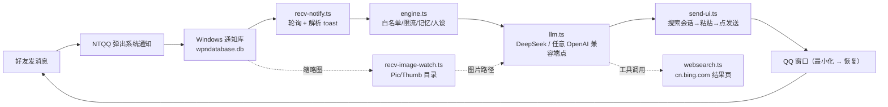

# QQ Bot · 零注入的 QQ 聊天机器人

把一个大模型接进 QQ 好友私聊和群聊。**不修改客户端、不注入 DLL、不碰协议**——
接收靠读 Windows 通知中心，发送靠模拟真人操作界面。

> 一句话：这是个"住在虚拟机里、看得见通知、会自己点鼠标打字"的机器人。
> 代价是所有动作都走真实 UI，所以它独占一台桌面、回得慢、不能和真人抢鼠标。

- **纯 Node 运行**：没有 `npm install`，`node src/index.ts` 直接跑（Node 22 原生跑 TS）
- **零注入**：不 patch QQ、不 hook 进程、不解析私有协议
- **可读的代码**：约 5000 行，每个"为什么这么写"都在注释里（踩过的坑都留着）
- **自带 WebUI**：`http://127.0.0.1:8787` 改配置、看日志、测连通，不用重启
- **会联网**：模型自己判断要不要查（function calling），不是关键词触发
- **能看图**：从 QQ 本地缩略图取图，交给多模态模型描述
- **记得住**：会话记忆、防重复、免打扰、长回复自动分条

---

## 它怎么工作的



### 接收：读通知，不读协议

QQ（NTQQ）收到消息会弹 Windows toast。toast 的 XML 就落在
`%LOCALAPPDATA%\Microsoft\Windows\Notifications\wpndatabase.db`（SQLite）里，
用 `node:sqlite` 只读轮询即可，`launch=` 里带 `peerUin / peerName / chatType / fuin`，
正文在 `<text>` 节点里。

三个必须知道的实测结论（不满足就收不到消息）：

| QQ 窗口状态 | 会不会弹系统通知 |
|---|---|
| 前台 / 桌面可见 | **不会** |
| 隐藏到托盘（`SW_HIDE`） | **不会** |
| **最小化（`SW_MINIMIZE`）** | **会** ← 只有这一种 |

所以机器人会在空闲时把 QQ 窗口**最小化**，不是隐藏。`tools/watchdog.ps1` 会定期把它按回去。

### 发送：像人一样点

`send-ui.ts` 的流程：恢复窗口 → 抢前台（`AttachThreadInput` + ALT + 临时放开
`SPI_SETFOREGROUNDLOCKTIMEOUT`）→ 搜索框输入会话名 → 双击打开 → 剪贴板 `Ctrl+V`
→ 点发送 → **截两次输入框比较像素**确认真的发出去（墨迹没下降就重试一次，仍失败就报错，
绝不假装成功）。

需要 `SetCursorPos` + `mouse_event` + UIA 读控件，全在 `tools/*.ps1` 里。

> 因为要抢前台，机器人只在"你连续 N 秒没碰键鼠"时才发送（`reply.sendIdleMs`，
> 默认 45s，最长等 10 分钟）。这就是它"回得慢"的真正原因。

---

## 快速开始

### 0. 环境

- Windows 10 / 11（发送依赖 Win32 UI 自动化，只支持 Windows）
- [NTQQ](https://im.qq.com/)（QQ 9.x 桌面版）
- Node.js **≥ 22.18**（实测 22.22.2；需要 `node:sqlite` 和原生 TS 支持）
- 一个**专用**的 QQ 号作为机器人账号，并在某台机器上保持登录
- 建议一台虚拟机：机器人要抢鼠标，别和你自己抢

### 1. 登录机器人 QQ

用机器人账号登录 NTQQ，打开一次「设置 → 基本设置」，确认：

- 关闭「关闭主面板时最小化到系统托盘」（否则窗口会缩回托盘，恢复逻辑会打架）
- 允许 QQ 弹系统通知（Windows 设置 → 通知 → QQ：开）

**不要**把 QQ 窗口留在桌面上不管——它开着就不会弹通知。交给 watchdog 最小化即可。

### 2. 配置

```bash
cp config.example.json config.json
```

改这几个字段（其余保持默认即可）：

| 字段 | 说明 |
|---|---|
| `botUin` | 机器人 QQ 号 |
| `botName` | 机器人 QQ **昵称**，必须一字不差（发送时靠它搜会话） |
| `providers[0].apiKey` | 模型 API key（默认 DeepSeek，任何 OpenAI 兼容端点都行） |
| `models.default` | 形如 `providerId/modelName`，例如 `deepseek/deepseek-flash` |
| `reply.groups` | 允许回复的群名数组；私聊由 `reply.private` 控制 |

也可以完全不碰文件：先跑起来，再在 WebUI 里填。

### 3. 启动

```bash
node src/index.ts        # 前台跑，看日志（等价于 npm run bot）
```

或者双击 `启动bot.bat`（= `tools/recover.ps1`：检查 QQ → 绑定进程 → 恢复窗口 → 起 bot → 健康检查），
它会顺便打开 WebUI。

### 4. 确认活着

```powershell
powershell -NoProfile -ExecutionPolicy Bypass -File tools\doctor.ps1
```

十项检查（QQ 进程 / bot 进程 / 窗口状态 / 会话解锁 / 心跳 / 通知库 / 接收 / 模型配置 / 接收模式），
最后打印 `VERDICT: HEALTHY`。出问题先看它，别猜。

### 5. 常驻（可选）

```powershell
powershell -NoProfile -ExecutionPolicy Bypass -File tools\install-autostart.ps1
```

注册两个计划任务：开机自启 + 每 5 分钟巡检的 watchdog（单实例，不会叠进程）。
**从终端直接启动的进程会被回收，只有计划任务可靠**——这是踩过的坑。

---

## 配置项速查

```jsonc
{
  "receive": "notify",        // notify（推荐）| db（读 NTQQ 加密库，需要密钥，已停用）
  "reply": {
    "private": true,          // 回私聊
    "groups": ["测试用群"],    // 回这些群（按群名）
    "maxPerMinute": 8,        // 限流：每分钟最多几条
    "readDelayMs": [500, 1600],   // 假装"看了一会儿"再回
    "typingSpeedCps": 14,     // 打字速度（字/秒），用来算"正在输入"的时长
    "splitSegments": 2,       // 长回复最多拆成几条发
    "quietHours": { "enabled": false, "start": "23:30", "end": "08:00" },
    "staleAfterMs": 600000,   // 超过 10 分钟的积压消息不回复（只归档）
    "sendIdleMs": 45000,      // 你 45 秒没碰键鼠才允许抢前台发送
    "sendMaxWaitMs": 600000   // 最多等 10 分钟，超时强行发
  },
  "search": { "enabled": true, "provider": "auto", "maxRounds": 2, "maxCalls": 3 },
  "webui": { "port": 8787, "host": "127.0.0.1", "token": "" }
}
```

- `search.provider`：`auto`（默认，走 `cn.bing.com` 结果页，零 key）/ `tavily` / `serper`
- `webui.host` 默认只听 `127.0.0.1`；要从宿主机访问就改 `0.0.0.0` 并放行防火墙
- 人设写在 `persona.md`，改完下一条消息生效（按 mtime 热加载）

---

## 目录结构

```
src/
  index.ts            入口：启动接收器 / WebUI / 心跳 / 窗口归位
  engine.ts           核心：白名单 → 限流 → 记忆 → 模型 → 发送，串行不抢焦点
  llm.ts              多厂商客户端（openai / anthropic / azure）+ 重试 + 工具循环
  send-ui.ts          发送适配器：搜索→粘贴→点发送→像素回执
  recv-notify.ts      接收适配器：轮询 wpndatabase.db，解析 QQ toast
  recv-image.ts       看图：从本地缩略图取图，多模态模型出描述
  recv-image-watch.ts 图片第二通道：QQ 有时不发通知，直接盯 Thumb 目录
  websearch.ts        联网：Bing/Tavily/Serper + 正文抓取 + 工具定义
  plain.ts            发送前拍平 markdown（QQ 不渲染 ** 和 #）
  config.ts           配置中心：原子写 + 热加载 + 老格式迁移
  memory.ts           会话记忆（token 预算，超了丢最旧的）
  plugins.ts          插件钩子：messageGate / beforeReply / afterReply / afterSend
  webui.ts            管理界面（配置 / 日志 / 连通测试）
  runtime.ts          运行时状态与环形日志
  heartbeat.ts        心跳与健康信号
  dbcrypt.ts          历史遗留：NTQQ 库解密（db 模式用，已不推荐）
  recv-db.ts          历史遗留：db 模式接收器
tools/                所有 PowerShell 辅助（必须 ASCII-only，见下）
webui/                前端三件套（无构建、无框架）
plugins/              四个示例插件
persona.md            人设
HANDOFF.md            开发全过程记录（踩坑日记，最有信息量的文档）
```

### 值得一读的文档

| 文件 | 内容 |
|---|---|
| `HANDOFF.md` | 完整开发记录：每个坑怎么发现的、错误长什么样、为什么这么改 |
| `RECOVERY.md` | 挂了怎么救（进程、窗口、登录态、断网） |
| `VM-SETUP.md` | 虚拟机从零配置（含电源/更新/远程桌面） |
| `WEBUI.md` | 管理界面每个开关的含义 |
| `OFFLINE-RISKS.md` | 断网 / 睡眠 / 重启会发生什么（风险清单 R-xx） |

---

## 常用工具

| 命令 | 作用 |
|---|---|
| `tools\doctor.ps1` | 十项健康检查，出问题先跑这个 |
| `tools\recover.ps1` | 一键自救：起 QQ、绑进程、恢复窗口、起 bot |
| `tools\watchdog.ps1 -Loop -ParkWindow` | 常驻巡检：QQ 掉了拉起、窗口乱了按回最小化、发送中不打扰 |
| `BOT_TEST_PEER=张三 node tools\test-ask.mjs "问题"` | 把一句话当私聊喂进来，走完整链路并真发一条（验证改动）。必须给 `BOT_TEST_PEER`，否则不知道回给谁 |
| `node tools\test-web.mjs "问题"` | 只看联网：搜没搜、搜到什么、怎么答 |
| `node tools\test-vision.mjs <图片>` | 只看看图能力 |
| `node tools\test-plain.mjs` | markdown 拍平的自检（纯函数，11 项） |
| `node tools\selftest-send.mjs` | 发送链路自检（默认只粘贴+清空，`--send 张三` 才真发） |
| `node tools\mock-llm.mjs 8899` | 假模型服务，测 WebUI 加厂商/连通性时用 |

> `tools/*.ps1` 有一条硬约束：**只能写 ASCII**。PowerShell 5.1 在没有 BOM 时按 ANSI 解析，
> 中文注释会把下一行语句一起吞掉（表现为"某条命令莫名其妙没执行"）。改这些文件请保持英文注释。

---

## 已知限制（重要，先读再部署）

1. **独占桌面**：发送要抢前台、移动鼠标、模拟按键。机器人运行的这台机器不能同时给人用。
   想边用边跑，就用虚拟机。
2. **回复慢**：模型 + （可选）联网 + 拟人延时 + 等空闲，一条回复几十秒到两分钟很正常。
3. **必须最小化窗口**：QQ 窗口在前台或已隐藏时**不会**产生系统通知，机器人就收不到消息。
4. **断网期间的私聊直接丢弃**：没有重试队列（有意为之——补发的旧答案比不回更糟）。
5. **QQ 版本敏感**：窗口结构、控件名、toast 格式都可能随版本变。出问题先跑 `doctor.ps1`，
   再对照 `HANDOFF.md` 里"某个报错 → 某处改动"的记录。
6. **不要手动最大化 QQ 窗口再离开**：watchdog 会在几分钟内重新最小化，这期间的发送可能失败。
7. **图片有边界**：多人同时发图可能串会话；表情走 `Emoji` 目录；“图里套图”只能看到文字。
8. **合规**：这是自动化操作真实账号，行为等同于人在用 QQ。请遵守腾讯的服务条款，
   只用自己可控的账号，不要用来群发、营销或骚扰。

---

## 仓库里没有的东西

| 没进来 | 为什么 |
|---|---|
| `config.json` | 含真实 API key。用 `config.example.json` 复制一份改 |
| `data/` | 聊天记录、通知快照、截图、日志，18MB 本机隐私 |
| `patch/` | 早期"给 QQ 安装目录打补丁注入 loader"的方案，与零注入目标冲突，已废弃 |
| 一次性逆向脚本（`mem-*`、`salt-*`、`keysearch` 等） | 当初为了找 NTQQ 数据库密钥写的探针，接收改走通知库后已无用 |
| `.workbuddy/`、各种 `*.log` / `*.bmp` | 调试残留 |

---

## 隐私

- 聊天记录、通知快照、截图全部落在本机 `data/`，`.gitignore` 已排除，不会进仓库。
- API key 只存在本机 `config.json`（同样被忽略）；WebUI 只把打码后的 key 发给浏览器。
- 仓库里**不含**任何密钥、聊天数据或真实账号（示例配置用占位符）。
- 联网功能只发 GET、只读公开网页，不带本机信息、不登录、不提交表单。

---

## License

[MIT](LICENSE) © 2026 TransForm-sys

随便用、改、商用、闭源分发都行，只要保留版权声明。软件按"现状"提供，不担保任何事——
真拿去挂线上被腾讯封号，责任在你自己。
